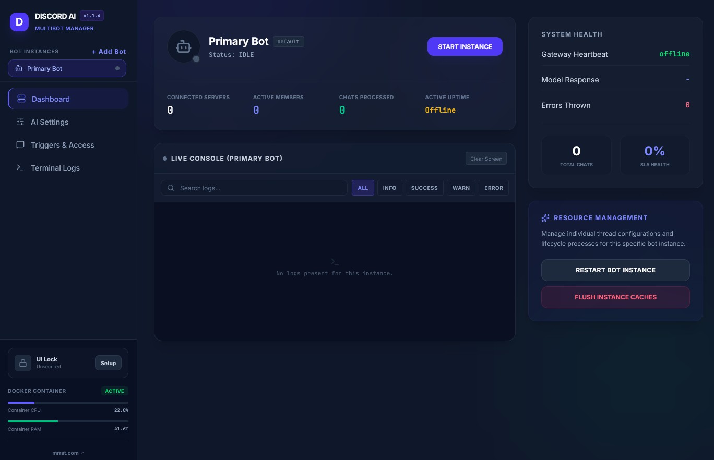

# 🤖 Discord AI Multibot Manager
A self-hosted web dashboard and management service to deploy, configure, monitor, and auto-start multiple independent AI-powered Discord bots simultaneously. Features real-time log streaming for each bot, individual target LLM settings, system resource metrics, and auto-start recovery using OpenAI or Gemini API compatible backends.



---

## 🛠 Prerequisite: Create Your Discord Bot
Setting up a Discord Bot for the first time can be confusing. Follow these exact steps to obtain the correct keys and grant the necessary permissions.

### Step 1: Create a Discord Developer Application
1. Go to the [Discord Developer Portal](https://discord.com/developers/applications) and log in with your Discord account.
2. Click the **New Application** button in the top right.
3. Give your bot a name (e.g., `My AI Assistant`) and click **Create**.

### Step 2: Retrieve Your Bot Token (Crucial)
> ⚠️ **Newbie Warning:** The token you need is the **Bot Token**. It is **NOT** the "Client ID", "Client Secret", or "Public Key" shown on the *General Information* page. Treat your Bot Token like a password—never share it.

1. In the left-hand menu, click on the **Bot** tab.
2. Under the username section, click the **Reset Token** button.
3. Confirm the reset, and a long string of characters separated by dots (e.g., `MTg4M...`) will appear.
4. Click **Copy** and save it somewhere secure immediately. *Note: Once you leave this page, Discord will hide it, and you will have to reset it again to copy it.*

### Step 3: Enable Privileged Gateway Intents (Mandatory)
If you do not do this step, the bot will join your server but will be unable to read any messages or respond to anything.

1. While still on the **Bot** tab, scroll down to the **Privileged Gateway Intents** section.
2. Locate the following three switches and toggle them **ON**:
   - **Presence Intent**
   - **Server Members Intent** (Allows the bot to see member statistics)
   - **Message Content Intent** (⚠️ **Absolutely CRITICAL!** Allows the bot to read messages so it can process AI queries)
3. Click **Save Changes** at the bottom of the screen.

### Step 4: Generate Your Bot Invitation Link
1. In the left-hand menu, navigate to **OAuth2** and select the sub-item **URL Generator**.
2. In the **Scopes** grid, check only the box for **bot**.
3. A new **Bot Permissions** grid will appear below. Check the following permissions:
   - **Read Messages/View Channels**
   - **Send Messages**
   - **Embed Links**
   - **Attach Files**
   - **Read Message History** (Crucial so the bot understands conversation context)
4. Scroll to the bottom of the page and locate the **Generated URL**.
5. Copy this URL, paste it into a new browser tab, select your Discord server, and click **Authorize**. Your bot is now added to your server!

---

> 💡 **Multibot Management Note:** Since this application supports running **multiple independent bots simultaneously**, you can repeat the prerequisite steps above for each Discord bot account you wish to create. Each bot in your dashboard will have its own custom token, custom prompt, and custom trigger behaviors!

---


## 🐋 Deploying with Portainer
Portainer is a powerful UI for managing Docker containers. You can deploy this service easily as a Portainer **Stack** (Docker Compose).

### Step 1: Create a New Stack in Portainer
1. Open your Portainer dashboard.
2. Navigate to your local environment -> **Stacks** in the left sidebar.
3. Click the **Add stack** button in the top right.
4. Name your stack (e.g., `discord-ai-bot`).

### Step 2: Paste the Docker Compose Configuration
In the **Web editor** box, paste the following `docker-compose.yml` configuration:

```yaml
version: '3.8'

services:
  discord-ai-multibot-manager:
    image: node:20-alpine
    container_name: discord-ai-multibot-manager
    restart: unless-stopped
    working_dir: /app
    ports:
      - "3010:3000"
    volumes:
      # Mount the entire project folder from your host (e.g. Synology NAS volume)
      - /volume1/docker/discord-ai-multibot-manager:/app
    environment:
      - NODE_ENV=production
    # This automatically installs, compiles, and starts the application inside the container
    command: sh -c "npm ci --include=dev && npm run build && npm run start"
```

### Why we use Volumes
Without a volume, any settings you change in the web dashboard (like your Discord Token, prompts, and OpenAI/Gemini API Keys) will be wiped out whenever the container reboots or gets updated. 
The configuration above mounts your host project directory to `/app` inside the container to keep your `config.json` safe.  ⚠️ CRITICAL: all the files from this project need to be in the folder specified under "volumes" in the YAML; i.e. `/volume1/docker/discord-ai-multibot-manager`

### Step 3: Deploy the Stack
1. Scroll down to the bottom of the stack creation page.
2. Click **Deploy the stack**.
3. Wait about 1-2 minutes for Portainer to pull the Node image, install dependencies, compile the application, and start the web dashboard.

### Alternative: build the image with Docker Compose
If you have the project folder on a machine with Docker (and not just Portainer's web editor), you can build a proper image instead of compiling on every start. From the project folder run:

```bash
docker compose up -d --build
```

This uses the `Dockerfile` and the `docker-compose.yml` in this repo. The dashboard is on port `3010`, and settings are stored in `./data/config.json`. If you are switching from the Portainer setup above, move your existing `config.json` into a `data` folder first (`mkdir data && mv config.json data/`) so your bots carry over.

---

## 💻 Initial Dashboard Setup

1. Open your web browser and navigate to `http://<your-server-ip>:3010` (or whichever port you mapped your container's port `3000` to, e.g., `http://localhost:3010`).
2. You will be greeted by the **Discord AI Multibot Manager** dashboard.
3. **Select or Create a Bot Instance**:
   - By default, a **Primary Bot** instance is pre-configured.
   - To add more bots, click **+ Add bot** in the top-right of the **Bot Instances** sidebar panel, enter a name, and hit create.
4. **Configure Your Bot Instance**:
   - Select your bot from the left sidebar.
   - Go to the **AI Settings** tab to set:
     - **Bot Instance Name**: Custom nickname for your dashboard.
     - **API Target Endpoint & Key**: Configure your OpenAI API compatible backend (Open WebUI, Gemini, OpenAI official, etc.)
       > 💡 **Gemini API Tip:** Enter `https://generativelanguage.googleapis.com/v1beta/openai` as your base URL.  Go to `https://aistudio.google.com/projects` to create a project and get a key. 
     - **Target AI Model ID**: Use custom IDs or fetch the automatic list from your endpoint.
   - Go to the **Triggers & Access** tab to set:
     - **Discord Token**: Paste the token copied in *Prerequisite: Step 2*.
     - **Behavior**: Choose if the bot responds to direct mentions, DMs, or custom prefixes (e.g., `!`).
     - **Channel/Guild Whitelists**: Restrict the bot to specific Discord channels or server IDs if desired.
     - **Auto-Start**: Toggle **Auto-Start on Reboot** so this specific bot instance logs back into Discord automatically when the container restarts.
5. **Save and Start**:
   - Click **Save Settings** at the bottom of the configuration forms.
   - Click the **Start Bot** button in the header bar or the dashboard actions panel.
6. **Monitor and Manage**:
   - Use the **Dashboard** and **Terminal Logs** tabs to view live logs, track connection latency, and check active guild/member count.
   - Keep track of total chats, system SLA metrics, and Docker container CPU/RAM allocations directly from the sidebar.
7. **Secure Your Instance (UI Security Lock)**:
   - Located at the bottom of the left sidebar is the **UI Lock** status card. Until a passcode is set, anyone who can open the dashboard can control your bots, so set one right away.
   - Click **Setup** and choose a passcode of at least 6 characters. Unless your browser is on the server itself, you will also be asked for the **one-time setup token**. It is printed in the server log at startup while no passcode is set; in Portainer or Synology Container Manager, open the container's **Logs**. This stops someone else on your network from claiming the dashboard first.
   - Once a passcode is set, the dashboard, live logs and every bot control require it. A browser stays signed in for 12 hours (or until you click **Lock**, change the passcode, or restart the container).
   - Saved Discord tokens and API keys are never sent to the browser, locked or not. The fields show that a value is saved; type a new one to replace it. Leaving a field blank keeps the saved value.
   - Repeated wrong passcodes are slowed down (5 tries per 15 minutes per address).
   - **Accidental Lockout Protection**: clicking **Lock** asks you to type your passcode first, so a typo during setup can't lock you out.
   - **Forgot the passcode?** Stop the container, delete the `adminPasscodeHash` line from `config.json`, and start it again. A new setup token will be printed in the log.

8. **Abuse protection in Discord**:
   - Bot replies can never ping `@everyone`, `@here`, roles or other users, whatever the AI writes.
   - Each bot has a **Per-User Cooldown** (Triggers & Access tab, default 5 seconds). Messages sent faster than that get a ⏳ reaction instead of an AI reply.

---

## 🔄 Upgrading from 1.1.x
- Your existing passcode keeps working. It is converted to a secure hash in `config.json` the first time the new version starts.
- When a passcode is set, the dashboard no longer shows anything until you unlock it.
- **If your dashboard was ever reachable by other people on your network or the internet, reset your Discord bot tokens and AI API keys.** Earlier versions sent them to any browser that asked, even while locked.
